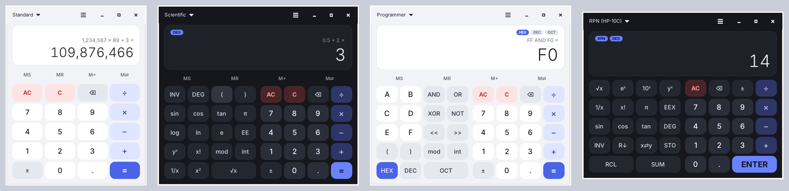

# XCalc

A modern GTK3 calculator built on the classic X11 `xcalc` math engine
(TI-30 algebraic notation and HP-10C reverse Polish notation).



## Features

- **Standard**, **Scientific**, **Programmer** and **RPN (HP-10C)** modes
- Light, dark or system appearance
- Thousands separators, an expression line, memory keys
- INV key that relabels sin/cos/tan/log/ln; DEG/RAD/GRAD cycle
- Programmer mode: HEX/DEC/OCT, AND/OR/XOR/NOT, shifts; invalid digits are disabled
- Full keyboard control, copy and paste
- 12 significant digits

## Build and install

Requirements: a C compiler, [Meson](https://mesonbuild.com) (>= 1.1) with Ninja,
and the GTK 3 development files (`libgtk-3-dev` on Debian/Ubuntu,
`gtk3-devel` on Fedora).

```sh
meson setup build
meson compile -C build
meson test -C build
sudo meson install -C build
```

Autotools is also supported (needs `autoconf`, `automake` and `xorg-macros`):

```sh
./autogen.sh --prefix=/usr/local
make && make check && sudo make install
```

This installs `xcalc`, `xcalc.desktop`, the icon and the man page.

## Usage

```
xcalc [--mode=standard|scientific|programmer|rpn] [--rpn]
      [--theme=system|light|dark]
```

The mode and appearance are remembered in `~/.config/xcalc/settings.ini`.

### Keyboard

| Keys | Action |
|------|--------|
| `0-9 . + - * / =` , `Enter` | digits and basic operators |
| `BackSpace` | erase last digit |
| `Esc` | clear entry (press twice to clear all) |
| `Delete` | all clear, including memory |
| `^ ! % ( )` | power, factorial, modulus, parentheses (Scientific/Programmer) |
| `n` | change sign |
| `s c t l g r p e i d` | sin, cos, tan, ln, log, sqrt, pi, e, INV, DEG (Scientific) |
| `a-f x & \| < > ~` | hex digits, XOR, AND, OR, shifts, NOT (Programmer) |
| `F5 F6 F7` | HEX / DEC / OCT (Programmer) |
| `Ctrl+C` `Ctrl+V` `Ctrl+Q` | copy result, paste number, quit |

In RPN mode `Enter` (or `Space`) is ENTER; STO, RCL and SUM are followed by a
digit 0-9.

## Project layout

| File | Purpose |
|------|---------|
| `math.c`, `actions.c`, `xcalc.h` | original calculator engine and a name-based action dispatcher |
| `xcalc.c`, `style.h` | GTK3 front-end and CSS themes |
| `tests/test_engine.c` | headless engine tests |
| `data/` | desktop entry and icon |

The UI strings are marked with `_()`/`N_()` in `xcalc.c`, ready for gettext.

## License and credits

X11 (MIT) license, see [COPYING](COPYING). The calculator engine was written by
John H. Bradley, Mark Rosenstein and Donna Converse and is part of
[upstream xcalc](https://gitlab.freedesktop.org/xorg/app/xcalc).
